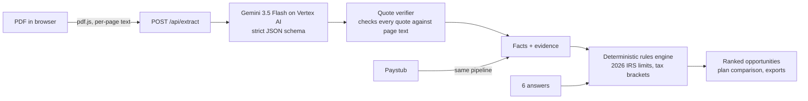

# LeftOnTable

**Get every dollar your job already promised you.**

LeftOnTable is a B2C web app for US employees. You upload your employer's benefits guide (and, optionally, a paystub). AI reads the fine print, the app checks it against what you actually use, and you get a ranked list of the money you're leaving on the table each year: unclaimed 401(k) match, employer HSA deposits, pre-tax daycare and commuter accounts, unclaimed stipends, and a cheaper health plan for how you actually use care. Every dollar figure comes with the exact quote and page it was based on, plus step-by-step instructions to claim it.

> Hackathon track: **01 · Money** · Audience: US adults 25–45 with jobs · Model: B2C · Platform: web only · No sign-up or login required.

| | |
|---|---|
| **Try it** | Run locally (below) → click **Try a sample employee**. A 31-page guide and a paystub are analyzed end to end with the real AI pipeline in about 10–15 seconds. |
| **Test documents** | [`Data for checking the app/`](Data%20for%20checking%20the%20app/README.md): 5 fictional employers, guides of 24–31 pages plus 2-page paystubs, with expected results |
| **Pitch deck** | [`pitch/LeftOnTable-pitch-deck.pdf`](pitch/LeftOnTable-pitch-deck.pdf) (10 slides) |

---

## Contents

1. [The problem](#1-the-problem)
2. [Who it's for](#2-who-its-for)
3. [What the product does](#3-what-the-product-does)
4. [How it works](#4-how-it-works)
5. [Why the numbers can be trusted](#5-why-the-numbers-can-be-trusted)
6. [Tested on real documents](#6-tested-on-real-documents)
7. [What we sell and why users come back](#7-what-we-sell-and-why-users-come-back)
8. [Business potential](#8-business-potential)
9. [Why it's new](#9-why-its-new)
10. [How this maps to the judging criteria](#10-how-this-maps-to-the-judging-criteria)
11. [Tech stack and code tour](#11-tech-stack-and-code-tour)
12. [Run, test and deploy](#12-run-test-and-deploy)
13. [Privacy and security](#13-privacy-and-security)
14. [Known limitations](#14-known-limitations)
15. [Roadmap](#15-roadmap)

---

## 1. The problem

Every year US employers publish a 30–50 page benefits guide. Most of its value only pays out if the employee acts: raises a contribution rate, opens an account, enrolls in a stipend or picks the right plan. Most people click "keep my elections" and move on.

| Signal | Data | Source |
|---|---|---|
| Unclaimed 401(k) match | **1 in 4** workers don't save enough to get the full employer match. Typical shortfall **$1,336/yr**, about **$24B/yr** in total | Financial Engines, *Missing Out* (reported by SHRM, PlanSponsor) |
| FSA forfeitures | **$4.5B** forfeited in 2023. **47%** of FSA holders lost money | EBRI data via Money.com |
| Plan choice | **76%** of workers make health-benefit decisions without fully understanding their plan. Half of enrollees spend **under an hour** choosing | Aflac WorkForces Report; EBRI |
| Reach | **72%** of private-industry workers have access to employer medical plans (87% of full-time) | BLS Employee Benefits Survey, March 2025 |

The money is already budgeted by the employer. It is lost only because nobody translates the document into "do these three things on Monday."

## 2. Who it's for

- **Who:** full-time US employees, 25–45, salaried or hourly, roughly $35k–$170k.
- **Where:** companies, hospitals, school districts and retailers with real benefit packages.
- **Life stage:** partner, kids in daycare, a commute, student loans. These are the people with the most money at stake.
- **Pain:** busy, not a benefits expert, afraid of picking wrong, never reads the PDF.
- **When they need us:** open enrollment (every November), starting a new job (31 days to enroll), a life event (baby, marriage, move), every payday.

Illustrative persona (from our demo documents): **Jordan Rivera, 34**, Chicago, married, toddler in daycare, $90k. The app finds **$10,992/yr**:

| Missed opportunity | $/yr |
|---|---|
| On the PPO "to be safe" when the HDHP + $1,500 employer HSA money is cheaper for this usage | 3,024 |
| Pays daycare with after-tax money (no Dependent Care FSA) | 1,845 |
| Saves 3% when the full match needs 6% | 1,800 |
| Never enrolled in the $100/mo transit subsidy + pre-tax transit | 1,525 |
| Learning budget, wellness reimbursement, phone stipend, Health FSA, $300 wellness credit hidden on page 24 | 2,798 |

## 3. What the product does

**User flow (about 60 seconds, no account):**

1. **Upload the benefits guide.** Any US employer PDF. It is parsed in the browser, and AI analysis starts immediately in the background.
2. **Add a paystub (optional).** PDF or phone photo. The app auto-fills salary, pay frequency, state and 401(k)/403(b) rate, and detects your current medical plan and coverage tier by matching the paystub premium against the guide's premium tables, including salary-banded tables.
3. **Answer 6 quick questions:** filing status, coverage, expected medical usage, childcare, commute, education plans.
4. **Get your money, ranked.** Each card shows dollars per year, why it applies to you, numbered steps to claim it, the math, the deadline, and the verbatim quote plus page from your guide marked ✓ verified.

**On the results page:**
- **Live recalculation.** Change salary, contribution rate, state, plan or usage in the sidebar and every number updates instantly, with no new AI call.
- **"Already doing this"** removes a card from the total.
- **Health plan comparison** for every plan in the guide: premiums, expected out-of-pocket, employer HSA money, tax savings and net cost for your usage. Region-restricted plans are flagged and never recommended.
- **Exports:** copy the action plan, a pre-written email to HR, an `.ics` calendar file with deadlines, and save as PDF.
- **Free perks** without a dollar value (EAP, legal plan, backup care, fertility benefits) are listed separately and never inflate the total.

**What it checks (9 categories):** 401(k)/403(b)/457(b) match gap · employer HSA seed money · HSA tax savings · Health FSA / Limited Purpose FSA · Dependent Care FSA (incl. employer contributions) · commuter subsidies + pre-tax transit/parking · health plan choice · ESPP (incl. lookback) · tuition, student loans and stipends (wellness, phone, internet, home office, learning, uniform, classroom supplies, etc.).

## 4. How it works



**AI reads, code counts.** The model never produces a dollar amount shown to the user. It only extracts facts into a strict schema, each with a verbatim quote and page number:

```json
"retirement": {
  "matchTiers": [{ "matchRate": 1, "percentOfPay": 4 }, { "matchRate": 0.5, "percentOfPay": 2 }],
  "evidence": { "page": 21, "quote": "Acme matches 100% of the first 4% of pay you contribute, plus 50% of the next 2% of pay.", "verified": true }
}
```

The rules engine ([`src/lib/engine.ts`](src/lib/engine.ts)) then computes, for example:

```
Full match: contribute 6% → employer adds 5% of pay
Now:        contribute 3% → employer adds 3% of pay
Left on the table: $90,000 × (5% − 3%) = $1,800 / yr
```

**What the engine models:**
- Multi-tier match formulas, annual match caps (e.g. "50% of first 8%, max $6,000"), non-elective/core contributions.
- Marginal tax rates: 2026 federal brackets for single/married/head of household, approximate rates for all 50 states + DC, and FICA with the Social Security wage base ([`src/lib/tax.ts`](src/lib/tax.ts)).
- Different tax treatment by account: 401(k) deferrals still pay FICA; HSA/FSA/commuter do not; **California and New Jersey tax HSA contributions** at the state level.
- 2026 IRS limits: 401(k) $24,500, HSA $4,400/$8,750 (+$1,000 catch-up at 55), Health FSA $3,400, Dependent Care FSA $7,500 (2026 OBBBA limit), commuter $340/mo, tuition $5,250 tax-free, ESPP $25,000.
- Health plan cost model: deductible → coinsurance → out-of-pocket max, with individual vs family values. Copay-only plans are estimated at 10% of bills, and HDHPs that pay 100% after the deductible are handled correctly. Premiums are per paycheck, monthly or annual, by coverage tier, and **by salary band** when the employer prices coverage by pay.
- Plan-switch savings are computed against the current plan *with* its best tax-account usage, so FSA and plan-switch cards never double count.
- Weekly, biweekly, semimonthly and monthly pay.

## 5. Why the numbers can be trusted

| Safeguard | Where |
|---|---|
| Strict JSON-schema output (`responseJsonSchema`), temperature 0, nulls instead of guesses | [`schemas.ts`](src/lib/server/schemas.ts), [`gemini.ts`](src/lib/server/gemini.ts) |
| Extraction rules for hard cases: multi-tier matches, salary bands, multiple employee groups, region-only plans, "100% up to the IRS limit", money that doesn't go to the employee (charitable matching, PTO) excluded | [`prompts.ts`](src/lib/server/prompts.ts) |
| Every quote is verified server-side against the document text (normalized match, fragment match for table rows, ≥85% in-order word match), the page number is corrected if needed, and the UI shows ✓ verified or ⚠ paraphrased | [`verify.ts`](src/lib/server/verify.ts) |
| All dollar math is deterministic TypeScript, so the same inputs always give the same result | [`engine.ts`](src/lib/engine.ts) |
| Every card shows its math line (e.g. `$90,000 × (5% − 3%) = $1,800`) | [`results.tsx`](src/components/scan/results.tsx) |
| Optional or life-choice items (ESPP, tuition, student loans) are shown separately and not counted in the headline total | engine `kind: "optional"` |
| Region- or group-restricted plans are shown but never recommended | engine plan comparison |
| Model fallback chain (`gemini-3.5-flash` → `gemini-3-flash-preview`) | [`gemini.ts`](src/lib/server/gemini.ts) |

## 6. Tested on real documents

The pipeline was run on public 2026 benefits guides from real US employers and on our long fictional test set.

**Public employer guides**

| Guide | Pages | Time | Quotes verified |
|---|---:|---:|---:|
| DC Government 2026 | 47 | 11 s | 16/16 |
| ADP TotalSource FY26 | 38 | 25 s* | 16/16 |
| Lawrence Livermore National Lab 2026 (8 medical plans with tiered premiums) | 32 | 8 s | 13/13 |
| Bentley University 2026 | 24 | 8 s | 12/12 |
| The Ford Family Foundation 2026 | 1 | 5 s | 5/5 |

\* measured before switching to low-latency thinking mode.

**Fictional test employers** (in [`Data for checking the app/`](Data%20for%20checking%20the%20app/README.md), each run end to end in the browser)

| Employer | Guide | What it stresses | Result |
|---|---:|---|---:|
| Acme Corp (IL) | 31 p | 6-part demo, wellness credit buried on p. 24 | $10,992/yr, 20/20 quotes |
| Northgate Health System (TX) | 24 p | 403(b), match + 2% core, hourly nurse with overtime | $7,395/yr, 18/18 quotes |
| Brightline Software (WA) | 25 p | match cap already reached → correctly **no** match card; WA/OR-only HMO flagged | $6,462/yr, 16/16 quotes |
| Pacific Valley USD (CA) | 24 p | pension with no match, monthly pay, CA HSA taxation, Bay Area-only HMO | $8,395/yr, 13/13 quotes |
| Summit Outfitters (FL) | 25 p | weekly pay, **3 salary-banded premium tables**, 0% contribution | $2,424/yr, 13/13 quotes |

All 5 paystubs (biweekly, semimonthly, monthly, weekly; 403(b), Roth 401(k), pension) were parsed correctly, with 4/4 quotes verified on each.

The command-line harness [`scripts/test-extract.mjs`](scripts/test-extract.mjs) runs the same pdf.js extraction as the browser against any PDF, so anyone can reproduce these results.

## 7. What we sell and why users come back

| Plan | Price | What you get |
|---|---|---|
| **Scan** | $0 forever | Full benefits scan, paystub cross-check, claim plan, deadlines. The hook: see your number. |
| **Plus** | $6 / month | Paycheck monitoring every payday, FSA use-it-or-lose-it alerts, life-event re-checks, open-enrollment plan picker |
| **Household** | $99 / year | Two earners, two benefit packages: who should cover the kids, shared FSA/HSA caps |

Everything is free during the beta. Pricing is shown on the landing page.

**Why they come back tomorrow:** each payday is a checkpoint (did the new contribution rate apply? is the HSA deposit landing?). FSA balances need spending before December 31. Life events reopen elections. Open enrollment comes back every November. The product follows the money calendar the user already lives on.

## 8. Business potential

- **Market:** ~135M US private-sector workers, ~95M with an employer medical plan (BLS, 72%). Target segment of 25–45 full-time workers: ~45M (estimate).
- **Path to $100M ARR:** 1.4M Plus subscribers × $72/yr, about 3% of the target segment.
- **Unit economics:**
  - AI cost under $0.05 per scan, since a 30-page guide is about 25k input tokens on a Flash model;
  - gross margin ~90%;
  - LTV ~$97 ($6 × 18 months × 90%);
  - target CAC under $30.
  - CAC and retention are planning assumptions, not measured yet.
- **Why LTV > CAC is plausible:** the output is a dollar number people want to share ("I found $3,000 in my benefits"), open enrollment creates a yearly news cycle, and $6/month is small next to thousands found.

## 9. Why it's new

Benefits-guidance tools exist, but they are **bought by HR**. The company paying for the tool also pays for the match. LeftOnTable is paid by the person who claims the money.

| | LeftOnTable | HR-bought benefit tools | Budgeting apps | Reading the PDF yourself |
|---|:-:|:-:|:-:|:-:|
| Paid by the employee, not HR | ✓ | — | ✓ | free |
| Reads your employer's actual guide | ✓ | ✓ | — | ✓ |
| Works at any employer | ✓ | — | ✓ | ✓ |
| Cross-checks your paycheck | ✓ | — | — | — |
| Dollar value + steps + deadlines | ✓ | partial | — | — |
| Cites the page for every number | ✓ | — | — | — |
| 60 seconds, no sign-up | ✓ | — | — | hours |

## 10. How this maps to the judging criteria

| Criterion | Weight | Evidence in this repo |
|---|---:|---|
| **Does it work?** Product & engineering | 40% | End-to-end flow with real AI on any PDF (§3–4); deterministic engine (`src/lib/engine.ts`); quote verification (`src/lib/server/verify.ts`); tested on 5 public guides + 5 long test employers with every quote verified (§6); reproducible CLI harness; strict TypeScript, ESLint clean, production build passes |
| **What do we sell?** Value & retention | 20% | Free scan → $6/mo Plus → $99/yr Household (§7); payday, FSA deadline and life-event return loops |
| **Who do we sell to?** Problem & user | 15% | Sourced problem data (§1); defined segment and trigger moments; persona with itemized losses (§2) |
| **Why does it make money?** Business potential | 15% | ~95M covered workers, $100M ARR path, AI cost per scan, LTV/CAC logic (§8) |
| **Is it new?** Originality | 10% | Employee-side, employer-agnostic, paystub cross-check, cited and verified numbers (§9) |
| Pass/fail | — | B2C ✓ · web only ✓ · no login ✓ · pitch deck PDF ✓ · public repo ✓ |

## 11. Tech stack and code tour

**Stack:** Next.js 15 (App Router) · React 19 · TypeScript · Tailwind CSS v4 · pdf.js (client-side PDF parsing) · Google Gen AI SDK → **Gemini 3.5 Flash on Vertex AI** (service-account auth) · pdf-lib (test-document generator) · Vercel-ready.

```
src/
├─ app/
│  ├─ page.tsx                 Landing page: hero, why, how it works, what we check, pricing, FAQ
│  ├─ scan/page.tsx            The app: upload → paystub → profile → results
│  └─ api/extract/route.ts     Extraction endpoint (guide or paystub; text or scanned PDF/photo)
├─ components/scan/
│  ├─ scan-flow.tsx            State machine; background AI calls while the user fills the form; paystub autofill
│  ├─ results.tsx              Ranked cards, evidence quotes, plan comparison, live sidebar, exports
│  ├─ fields.tsx               Profile inputs
│  └─ dropzone.tsx             Upload UI with progress
└─ lib/
   ├─ engine.ts                Rules engine: match gaps, HSA/FSA/DCFSA/commuter/ESPP, plan costs, salary bands
   ├─ tax.ts                   2026 IRS limits, federal brackets, 50-state rates, FICA
   ├─ profile.ts               Paystub → profile mapping; plan + tier detection from premium deductions
   ├─ types.ts                 Shared data model
   ├─ client/read-file.ts      pdf.js per-page text extraction, scanned-PDF and photo fallback
   ├─ client/exports.ts        .ics calendar, action plan, HR email
   └─ server/
      ├─ gemini.ts             Vertex AI client, model fallback, low-latency thinking
      ├─ schemas.ts            JSON schemas for guide and paystub extraction
      ├─ prompts.ts            Extraction rules
      └─ verify.ts             Evidence verification
scripts/
├─ test-extract.mjs            CLI: run extraction on any PDF, print facts and verification rate
├─ make-samples.mjs            Generates all test documents (npm run samples)
└─ samples/                    Fictional employers, shared guide sections, paystub generator with exact tax math
pitch/                         Pitch deck source (HTML) + rendered PDF
Data for checking the app/     10 test PDFs + expected results
```

## 12. Run, test and deploy

```bash
npm install
cp .env.example .env.local    # set GOOGLE_SERVICE_ACCOUNT_BASE64 (base64 of a GCP service-account JSON with Vertex AI access)
npm run dev                   # http://localhost:3000
```

| Env var | Purpose | Default |
|---|---|---|
| `GOOGLE_SERVICE_ACCOUNT_BASE64` | Vertex AI credentials (or `GOOGLE_SERVICE_ACCOUNT_JSON`) | required |
| `GOOGLE_CLOUD_LOCATION` | Vertex AI region | `global` |
| `GEMINI_MODELS` | Comma-separated fallback chain | `gemini-3.5-flash,gemini-3-flash-preview` |
| `GEMINI_THINKING_LEVEL` | `LOW` (fast) or `HIGH` | `LOW` |

**Test:**
```bash
node scripts/test-extract.mjs "Data for checking the app/summit-outfitters-benefits-guide-2027.pdf"
node scripts/test-extract.mjs "Data for checking the app/summit-paystub-2026-11.pdf" paystub
npm run samples      # regenerate all test documents
npm run build        # production build (type-checks and lints)
```

**Deploy (Vercel):** import the repo, add the env vars above and deploy. The extraction route sets `maxDuration = 120`. The pdf.js worker is copied to `public/` by `postinstall`.

## 13. Privacy and security

- PDFs are opened **in the browser**. Only extracted page text is sent to the server; the file itself is sent only for scanned PDFs or photos, which need OCR.
- **Nothing is stored server-side:** no database, no file storage, no logs of document content. The result lives in the browser tab (`sessionStorage`) and disappears when the tab closes.
- No accounts, no tracking of personal data. Credentials live only in environment variables and are never committed.
- Request size limits and file-type checks on the API route.

## 14. Known limitations

We prefer to be explicit about what's estimated:
- Tax rates are marginal-rate estimates (state rates are approximate typical-earner rates), not a tax return.
- The plan cost model is simplified: copay-heavy plans are approximated, and networks and specific drugs are not modeled.
- Perks with a stated dollar value are counted unless they are clearly optional (ESPP, tuition, student loans, family-building), so a niche perk such as a bike-commuter benefit can still be counted for someone who doesn't use it. Users can remove any card with "Already doing this".
- English-language US guides only. Very long guides (> 600k characters) should be trimmed to the benefits summary.
- Business metrics (CAC, retention) are planning assumptions until we have users.

## 15. Roadmap

- **Now:** live MVP covering guide + paystub scan, 9 checks, plan pricing with salary bands, cited and verified sources, exports.
- **Next:** Plus subscription with payroll connections for automatic payday checks, shareable result card, saved profiles.
- **Later:** Household mode across two employers, life-event engine (baby, marriage, move), Spanish.

---

*Educational estimates, not tax, legal or investment advice. All sample employers, people and vendors in this repository are fictional.*
